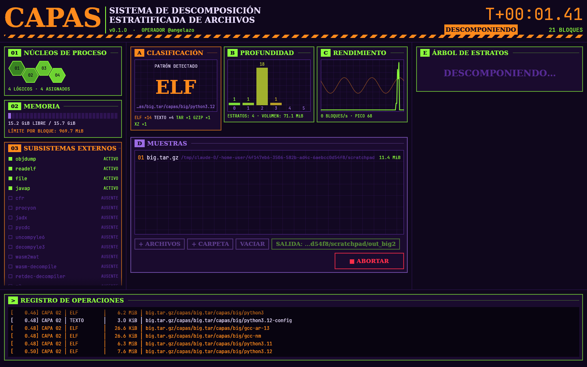
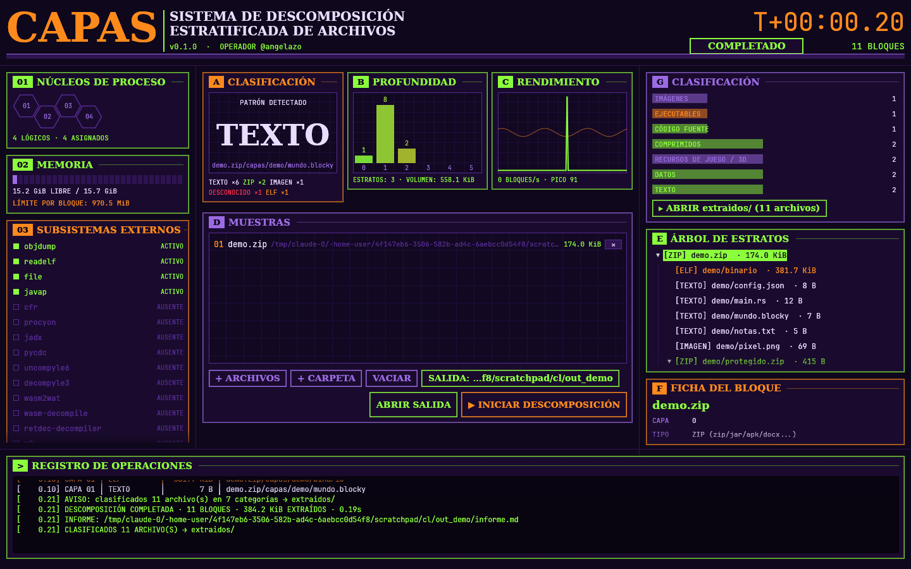
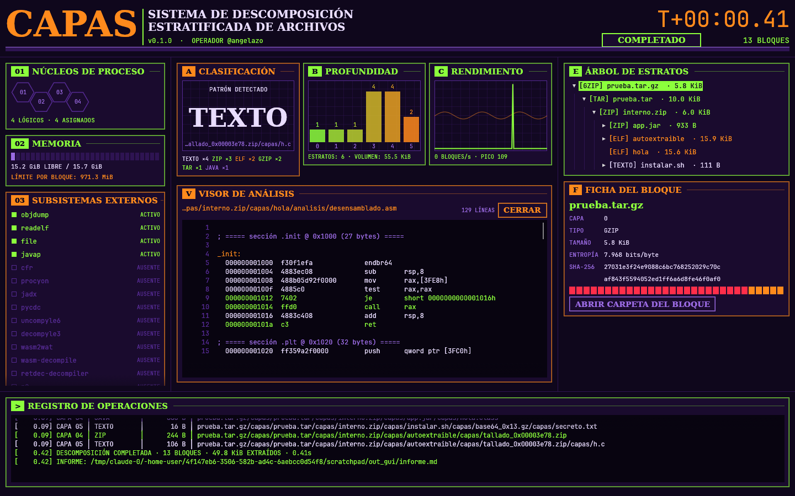
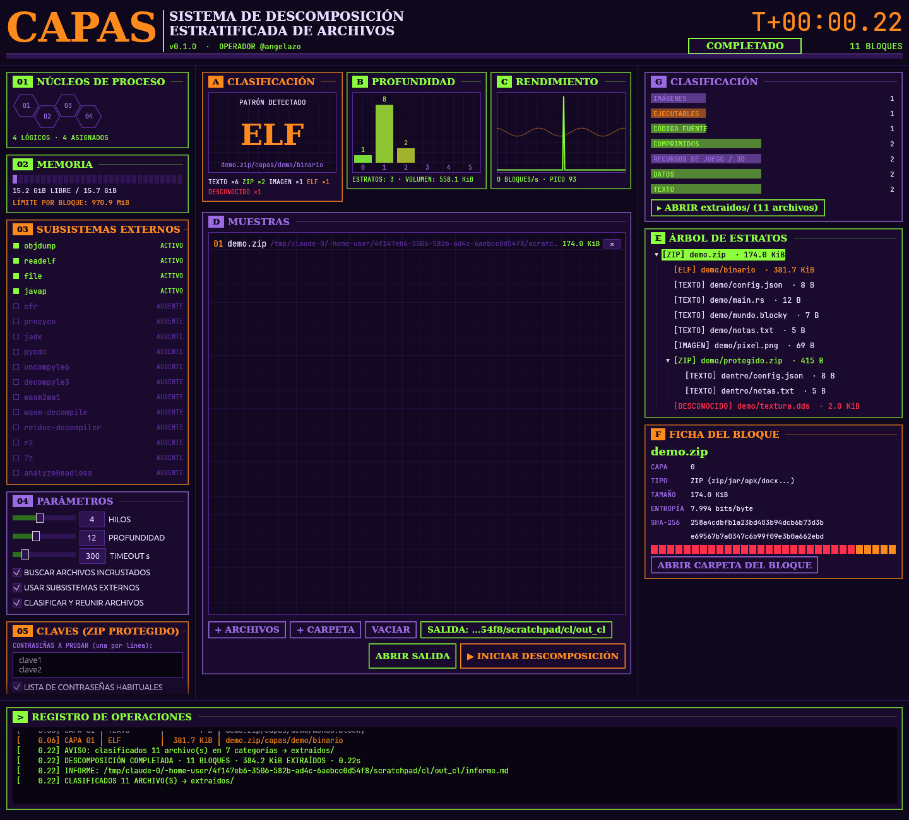
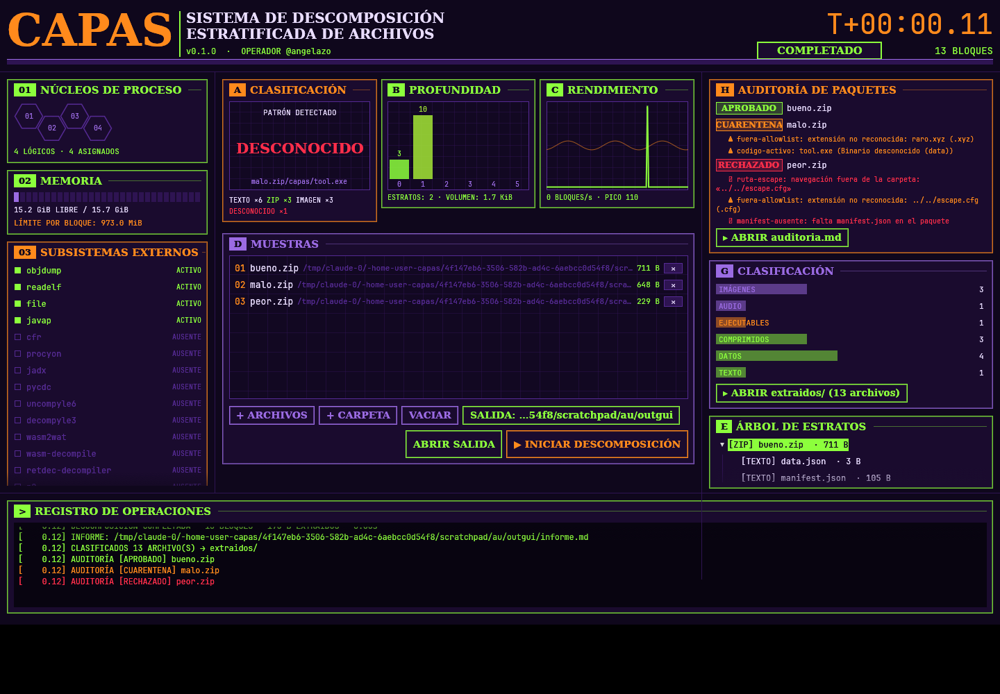

# capas

**por @angelazo**



Desmonta y decompila archivos **capa a capa** usando los recursos del ordenador:
todos los núcleos de la CPU, un límite de memoria ajustado a la RAM libre y las
herramientas de ingeniería inversa que tengas instaladas.

```
prueba.tar.gz  (GZIP)
└─ prueba.tar  (TAR)
   └─ interno.zip  (ZIP)
      ├─ app.jar (ZIP) ─ Hola.class ─> javap / CFR
      ├─ hola (ELF x86-64) ─> cabeceras, símbolos, desensamblado, objdump, Ghidra...
      ├─ autoextraible (ELF) ─ tallado_0x3e78.zip ─ h.c      ← zip escondido tras el binario
      └─ instalar.sh (texto) ─ base64_0x13.gz ─ secreto.txt   ← payload en base64
```

## Cómo funciona

Cada archivo es un **bloque**. Para cada bloque, `capas`:

1. **Identifica** el formato por su contenido (números mágicos), no por la extensión.
2. **Analiza / decompila** según lo que sea: desensambla los ejecutables, saca sus
   cabeceras y símbolos, descompila bytecode, extrae los textos y mide la entropía.
3. **Extrae la siguiente capa**: descomprime, abre el contenedor, talla archivos
   incrustados por firma… y obtiene los bloques hijo.
4. **Repite** con cada hijo, en **paralelo** sobre todos los núcleos, hasta que no
   quedan más capas o se alcanza la profundidad máxima.

El tamaño máximo de cada bloque en memoria se ajusta a la **RAM libre** y al número
de hilos. Los bloques con el mismo contenido (SHA-256) se analizan una sola vez, y
hay límites por bloque y totales para frenar las bombas de descompresión.

Al terminar, el **módulo de clasificación** agrupa todos los archivos finales por
categoría y el **módulo de claves** habrá abierto, por el camino, los ZIP
protegidos cuya contraseña estuviera entre las candidatas.



## Windows: `.exe` portable

`capas.exe` (x64) es **portable**: un único archivo, sin instalación ni DLLs
externas (solo usa las de Windows).

**Descarga directa:** [`dist/capas.exe`](https://github.com/AngelazoGit/capas/raw/main/dist/capas.exe)

Descárgalo y:

- **doble clic** → abre la interfaz gráfica;
- desde `cmd`/PowerShell → `capas.exe archivo.zip` funciona en consola.

Al ejecutarlo, Windows SmartScreen puede avisar de que es de un autor desconocido
(el ejecutable no está firmado con certificado): *Más información → Ejecutar de todas formas*.

## Compilar

```bash
cargo build --release
```

El ejecutable queda en `target/release/capas` (en Windows `capas.exe`). Es un único
programa: con interfaz gráfica y con modo consola.

En Linux, la interfaz necesita las bibliotecas de escritorio habituales
(`libxkbcommon-x11`, OpenGL); cualquier escritorio las trae.

Para generar el `.exe` desde Linux (compilación cruzada, un solo archivo portable):

```bash
rustup target add x86_64-pc-windows-gnu
sudo apt-get install -y gcc-mingw-w64-x86-64
cargo build --release --target x86_64-pc-windows-gnu
```

## Interfaz gráfica

```bash
./target/release/capas
```

```bash
./target/release/capas --gui archivo.zip
```

El primero abre la ventana vacía; el segundo la abre y empieza a analizar `archivo.zip`.

- **Muestras**: arrastra archivos o carpetas a la ventana (o usa *+ ARCHIVOS* / *+ CARPETA*) y pulsa **▶ INICIAR DESCOMPOSICIÓN**. *■ ABORTAR* lo detiene.
- **01 Núcleos**: un hexágono por núcleo; se encienden en verde mientras trabajan.
- **02 Memoria** y **03 Subsistemas externos**: RAM libre, límite por bloque y qué decompiladores se han encontrado.
- **04 Parámetros**: hilos, profundidad, timeout, búsqueda de archivos incrustados.
- **A Clasificación**: el último formato detectado, en grande.
- **B Profundidad**: cuántos bloques hay en cada capa.
- **C Rendimiento**: bloques por segundo en tiempo real.
- **E Árbol de estratos** y **F Ficha**: navega por las capas; pulsa un resultado (desensamblado, cabeceras, javap…) para verlo en el **visor** con resaltado.
- **Registro**: todo lo que ocurre, con marca de tiempo.



## Modo consola

```bash
./target/release/capas archivo1 archivo2 carpeta/ -s salida
```

Con archivos como argumentos (y sin `--gui`) funciona en la terminal.

```bash
./target/release/capas --recursos
```

`--recursos` muestra CPU, RAM y qué herramientas externas se han encontrado.

Opciones principales: `-j` hilos, `-p` profundidad máxima, `-t` timeout por
herramienta, `--max-archivo-mb`, `--max-total-mb`, `--sin-tallado`,
`--sin-externas`, `--max-instrucciones`.

## Qué hace en cada capa

| Formato | Interno (Rust) | Externo si está instalado |
|---|---|---|
| gzip, bzip2, xz, lzma, zlib, zip/jar/apk/docx, tar, ar/.deb, Mach-O fat | extracción | — |
| 7z, RAR, CAB | — | `7z` |
| PDF | extrae y descomprime los flujos | — |
| ELF / PE / Mach-O | cabeceras, secciones, importaciones, símbolos, desensamblado x86/x64 con etiquetas | `readelf`, `objdump`, `r2`, `retdec-decompiler`, Ghidra (`analyzeHeadless` o `GHIDRA_HOME`) → C |
| Clase Java | — | `javap`, `cfr`, `procyon` |
| DEX | — | `jadx` |
| .pyc | — | `pycdc`, `decompyle3`, `uncompyle6` |
| WebAssembly | — | `wasm2wat`, `wasm-decompile` |
| Texto/scripts | detecta cargas base64 embebidas | — |
| Audio/vídeo/fuentes/BD | OGG, WAV, MP3, FLAC, MP4, WebM, AVI, SQLite, TTF/OTF/WOFF… por contenido | — |
| Cualquier binario | cadenas ASCII/UTF-16, entropía y búsqueda de archivos incrustados por firma | `file` |

Lo que no se reconoce por contenido se recoge en **`desconocidos.txt`**: agrupa los
archivos por sus bytes mágicos y extensión, para poder ampliar la detección con los
formatos propios que aparezcan.

## Informe de plugins / código activo

Siempre que aparece **código** (ELF/PE/Mach-O o bytecode Java/DEX/.pyc/WASM), capas
escribe **`plugins.md`**: una lista consolidada de cada plugin/librería con sus
**funciones** y las **APIs que importa**, resaltando las **capacidades sensibles**:
red, ficheros, procesos, registro/persistencia y cripto. Así ves de un vistazo "qué
hace y qué toca" cada plugin, sin abrir carpeta por carpeta.

Combinado con la vigilancia de caché del cliente (`--solo-informe`), un plugin que un
servidor deje en tu caché queda capturado, clasificado como ejecutable, marcado por la
auditoría como código activo (→ cuarentena) y con sus funciones en `plugins.md`.
**capas no ejecuta el código**: es detección y análisis, no bloqueo.

## Módulo de clasificación

Al terminar, `capas` decide la **categoría** de cada archivo (por su contenido y su
extensión) y reúne una copia de todos en `extraidos/<categoria>/`, con un informe
`clasificacion.md`. Así tienes juntas todas las imágenes, los ejecutables, los
recursos de juego (`.blocky`, `.dds`, `.pak`, `.nbt`…), el código fuente, etc.

Categorías: imágenes, audio, vídeo, ejecutables, bytecode, código fuente,
documentos, comprimidos, recursos de juego / 3D, datos, texto y desconocidos.

Se desactiva con `--sin-clasificar`.

### Agrupar recursos relacionados

Los archivos que comparten nombre base en la misma carpeta (un `mundo.blocky` y su
`mundo.png`, su `mundo.json`…) son un mismo recurso repartido en varios archivos.
Con `--agrupar`, capas los junta en **un `.zip` por conjunto** en
`extraidos/conjuntos/<nombre>.zip`, y lista los conjuntos en `conjuntos.md`.

```bash
./target/release/capas pack.zip --agrupar -s salida
```

### Reconstruir paquetes (que vuelvan a funcionar)

`--reconstruir` rearma cada paquete con su **estructura de carpetas original** en
`extraidos/reconstruido/<paquete>/` y en un **`.zip` cargable**, usando los bytes ya
extraídos. Así cada archivo vuelve a encontrar sus dependencias por su ruta; si el
paquete venía **con contraseña**, el reconstruido sale ya descifrado y se abre sin
clave.

```bash
./target/release/capas pack.zip --reconstruir -s salida
```

Nota honesta: esto restaura la **estructura** (co-locación y rutas), que es lo que
hace que un pack cargue. No interpreta las referencias internas propias de cada
formato (eso es específico de cada juego); para esos casos, dime el formato.

## Módulo de claves (ZIP protegidos)

Para archivos **que tengas derecho a abrir** (tus propios ZIP con la contraseña
olvidada, retos CTF, análisis forense autorizado). Cuando `capas` encuentra un ZIP
cifrado, prueba las contraseñas candidatas; si acierta, lo abre y sigue pelándolo.

```bash
./target/release/capas paquete.zip --clave "mi clave"      # una o varias (--clave a --clave b)
```

```bash
./target/release/capas paquete.zip --comunes               # lista de contraseñas habituales
```

```bash
./target/release/capas paquete.zip --diccionario lista.txt # una contraseña por línea
```

```bash
./target/release/capas paquete.zip --fuerza-bruta d --fuerza-long 6   # solo dígitos, hasta 6
```

Soporta ZipCrypto clásico y AES. Alfabetos de fuerza bruta: `d` dígitos, `l`
minúsculas, `a` alfanumérico, `A` completo con mayúsculas, o los caracteres que
escribas. La prueba de cada contraseña se reparte entre todos los núcleos y hay un
tope de intentos (`--max-intentos`). No descifra AES con contraseña fuerte: solo
la encuentra si está entre las que se prueban. En la interfaz está en el panel
**05 CLAVES**.



## Módulo de auditoría (asset packs / mods)

Revisión **defensiva** de paquetes (asset packs, mods…) **antes de activarlos**:
sobre el árbol ya extraído —sin ejecutar nada— aplica reglas y da un veredicto por
paquete: **APROBADO**, **CUARENTENA** o **RECHAZADO**.

```bash
./target/release/capas pack1.zip pack2.zip --auditar -s revision
```

Reglas (alineadas con la guía de captura y auditoría de assets):

- **Rutas de escape** (zip-slip): `../`, rutas absolutas o `C:\…` → RECHAZADO.
- **Manifest** `manifest.json` ausente o no válido → RECHAZADO; si falta algún
  campo recomendado (Group, Name, Version, Authors, Dependencies…) se avisa.
- **Código activo / librerías nativas** (`.exe .dll .so .jar .class .bat .ps1`…) o
  ejecutables detectados por contenido → CUARENTENA.
- **Allowlist** de extensiones de recursos (`.json .png .ogg .model .animation`…);
  lo que queda fuera → CUARENTENA (revisar).
- Calcula SHA-256 (ya lo hacía) y escribe `auditoria.md` / `auditoria.json`.

En la interfaz es el panel **H AUDITORÍA DE PAQUETES** y se activa con la casilla
*AUDITAR PAQUETES*. Recuerda: un hash demuestra identidad, no inocencia; analiza los
paquetes en cuarentena con antivirus/sandbox y mantén el software actualizado.



### Modo vigilancia (puerta antes de la carga del servidor)

Para que **ningún pack llegue al servidor sin auditar**, capas puede vigilar una
carpeta y encaminar solo cada pack que aparece. La interceptación se hace
**controlando la carpeta de la que el servidor carga los mods**, no tocando la red
ni el TLS:

```
fuente no confiable ─▶ incoming/ ─▶ [capas audita] ─▶ approved/ (= Mods del servidor)
                                            └────────▶ quarantine/  (rechazados / a revisar)
```

```bash
./target/release/capas --vigilar /ruta/incoming \
    --aprobados /ruta/servidor/Mods \
    --cuarentena /ruta/quarantine \
    --reportes  /ruta/reports
```

Observa `incoming/`; cuando un pack termina de escribirse lo audita y lo mueve:
**APROBADO → `approved/`** (la carpeta de Mods), **lo demás → `quarantine/`**, con
el informe por pack en `reports/`. El servidor solo carga de `approved/` y el único
que escribe ahí es capas, así que la auditoría es obligatoria por diseño. Corre en
bucle (Ctrl-C para parar); `--intervalo` ajusta el sondeo. Si no indicas las
carpetas, se crean junto a `incoming/`.

> Interceptar por red/TLS o falsificar la carga **no** es el enfoque: hazlo sobre
> archivos que controlas, en la carpeta de la que el servidor lee, antes de activarlos.

### Vigilancia de caché del cliente (solo informe)

Si eres el **cliente** y un servidor te escribe archivos en tu **caché**, no puedes
moverlos ni borrarlos (el juego los necesita) ni bloquearlos antes de que se
carguen sin enganchar el cliente. Lo que sí puedes es **detectarlos**: capas vigila
la carpeta de caché (recursivo), y de cada archivo nuevo **audita y clasifica una
copia sin tocar el original**, avisándote del veredicto y de lo peligroso.

```bash
./target/release/capas --vigilar "/ruta/a/la/cache" --solo-informe
```

No mueve ni borra nada; los informes van a una carpeta `reports/` **fuera** de la
caché. Es **detección, no bloqueo previo**: el cliente puede haber cargado ya el
archivo cuando lo ves, pero te queda el aviso, la clasificación y una copia en
`reports/` para decidir (desconectar, borrar, revisar en sandbox). No toca la red
ni el cliente.

### Localizar la caché de una aplicación

¿No sabes dónde deja la caché una app? capas la busca por ti (solo mira el sistema
de archivos; no engancha el proceso ni la red):

```bash
# por nombre, en las carpetas de caché estándar del sistema
./target/release/capas --localizar-cache "MiJuego"

# observando: arranca la app y mira qué carpeta escribe de verdad (lo más fiable)
./target/release/capas --localizar-cache "MiJuego" --observar 15

# además, pistas de ruta dentro del propio ejecutable
./target/release/capas --localizar-cache "MiJuego" --exe "C:\\Juego\\juego.exe"
```

Busca en AppData/LocalLow/Temp (Windows), `~/.cache` · `~/.local/share` (Linux) o
`~/Library/Caches` (macOS). Con `--observar N` arrancas la app y capas detecta qué
carpeta recibe archivos nuevos en esos N segundos —esa es la caché, coincida o no
el nombre— y te da directamente el comando para vigilarla con `--solo-informe`.

## Salida

```
salida/
  informe.md         árbol de capas legible
  informe.json       el mismo árbol, para procesar
  clasificacion.md   archivos agrupados por categoría
  clasificacion.json
  desconocidos.txt   magic + extensión de lo no reconocido (para ampliar la detección)
  plugins.md         código activo con sus funciones y APIs (si hay ejecutables/bytecode)
  plugins.json
  conjuntos.md       recursos agrupados por nombre base (con --agrupar)
  auditoria.md       veredicto por paquete (con --auditar)
  auditoria.json
  extraidos/conjuntos/<nombre>.zip     cada conjunto de recursos junto (con --agrupar)
  extraidos/reconstruido/<pack>/ y .zip  paquete rearmado y cargable (con --reconstruir)
  extraidos/<categoria>/   una copia de cada archivo final, por categoría
  <archivo>/
    analisis/     cabeceras.txt, desensamblado.asm, objdump.asm, javap.txt, cadenas.txt...
    capas/<hijo>/ el archivo extraído + su propio analisis/ y capas/ (recursivo)
```

## Seguridad

- Las rutas de los archivos extraídos se sanean (sin `..` ni rutas absolutas).
- Límite por bloque y total de extracción contra bombas de descompresión.
- Los contenidos duplicados (mismo SHA-256) se analizan una sola vez.
- Los archivos analizados **nunca se ejecutan**; las herramientas externas tienen timeout.
- El módulo de claves es para archivos que tengas derecho a abrir (contraseñas
  propias olvidadas, CTF, forense autorizado). Trabaja sobre un único archivo que
  tú le das; tiene un tope de intentos y no descifra cifrado fuerte por fuerza bruta.

## Autor

Creado por **@angelazo**. La firma aparece en la ventana, en `capas --help`
y al final de cada `informe.md`. Licencia MIT (ver `LICENSE`).

La interfaz es un diseño original con una estética de "centro de mando" de anime de
los 90 (morado, verde neón y naranja). No usa logotipos, nombres ni recursos
de ninguna obra existente.
