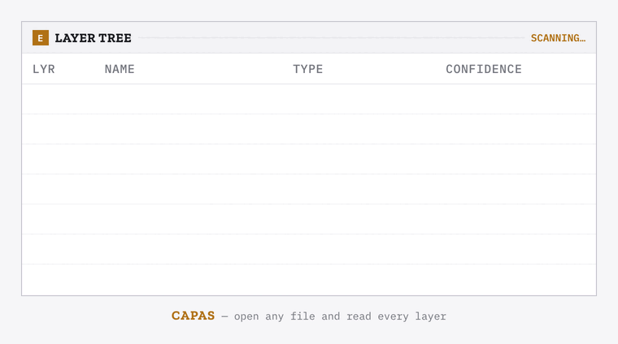
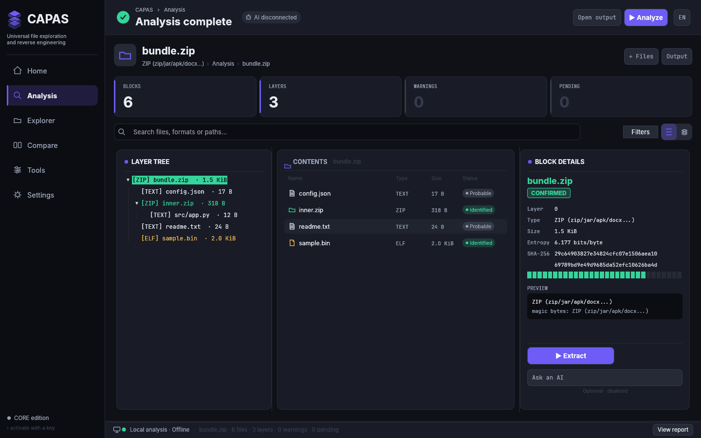

# capas — take any file apart, layer by layer

**by @angelazo** · [Español](README.es.md)

> **See what's really inside a file.** Drop in an archive, an executable, a game
> mod or a mystery blob and capas peels it open layer by layer — decompressing,
> decompiling, carving out hidden files and telling you, with evidence, what each
> piece actually is. Fast, offline, and it **never runs** what it inspects.





**Free and complete.** The whole analysis engine is free: 729 file formats across
every platform, parallel layer extraction, confidence levels, family relations, a
queryable SQLite index and full reports. Paid **Pro/Studio** editions add engine-bundle
unpacking and team/automation tooling — but you never hit a wall just trying to
understand a file.

- 🧅 **Layer-by-layer** extraction and decompilation, in parallel across every core
- 🔬 **Content-based detection** of **729 formats** in 11 categories (Windows, macOS, Linux, Android/iOS, consoles) — not just by extension
- 🏷️ **Confidence levels** (Confirmed / Compatible / Probable / Unknown) with the evidence behind each call
- 🔗 **Family relations** + a **SQLite index** you can query and diff between versions
- 🛡️ **Package audit** (APPROVED / QUARANTINE / REJECTED) for asset packs and mods — before a server ever loads them
- 🎮 **Engine bundle unpacking** (Unity, Godot) — *Pro*
- 🖥️ **GUI + console**, portable Windows `.exe`, **English/Spanish**, five masks
- 🧭 **Product UI**: sidebar (Home · Analysis · Explorer · Compare · Formats · Tools · Settings), stat cards, a three-pane analysis (layer tree · contents table · block details) and recent analyses
- 🤖 **MCP bridge** (`capas --mcp`): let a local or cloud AI (Claude Desktop, Ollama, OpenAI clients) use CAPAS's analysis as tools — CAPAS stays offline — *Studio*. See [MCP.md](MCP.md)

Take files (or folders) apart **layer by layer** and decompile them using your
computer's resources: every CPU core and a memory budget tuned to the free RAM.
**The whole engine is built in** — RAR, 7z, CAB, ISO, CHD and MSI, Java, Python
`.pyc`, Android DEX, WebAssembly and x86/ARM/MIPS binaries need **nothing installed**.
Heavy-weight engines (Ghidra, RetDec, radare2…) plug in optionally, one click away.

```
sample.tar.gz  (GZIP)
└─ sample.tar  (TAR)
   └─ inner.zip  (ZIP)
      ├─ app.jar (ZIP) ─ Main.class ─> listing + decompiled Java (built in)
      ├─ app (ELF x86-64 / ARM64) ─> headers, symbols, disassembly (built in), Ghidra…
      ├─ sfx (ELF) ─ carved_0x3e78.zip ─ main.c   ← zip hidden after the binary
      └─ install.sh (text) ─ base64_0x13.gz ─ secret.txt   ← embedded payload
```

A single program with a **graphical interface** and a **console mode**. Builds to a
portable Windows `.exe`. Default UI language is **English** (Spanish available), and
it ships with a dark **"Serious"** product theme by default, plus a light **"Clean"**
business mask and the **"Serene"**, **"Neutral"** and **"Command"** looks.

## How it works

Every file is a **block**. For each block, capas:

1. **Identifies** the format by its content (magic numbers), not its extension.
2. **Analyzes / decompiles** it: disassembles executables, pulls their headers and
   symbols, decompiles bytecode, extracts strings, measures entropy.
3. **Extracts the next layer**: decompresses, opens the container, carves embedded
   files by signature, and produces the child blocks.
4. **Repeats** on each child, in **parallel** across all cores, until there are no
   more layers or the depth limit is hit.

Identical blocks (same SHA-256) are analyzed once. There are per-block and total
limits to stop decompression bombs.

## Build

```bash
cargo build --release
```

The binary lands at `target/release/capas` (`capas.exe` on Windows).

### Windows: portable `.exe`

`capas.exe` (x64) is **portable**: a single file, no install, no external DLLs.
Double-click it for the GUI, or run `capas.exe file.zip` from a terminal for the
console mode. **Direct download:** [capas.dev/capas.exe](https://capas.dev/capas.exe)
(SmartScreen may warn because it is unsigned → *More info → Run anyway*).

Cross-compile the `.exe` from Linux:

```bash
rustup target add x86_64-pc-windows-gnu
sudo apt-get install -y gcc-mingw-w64-x86-64
cargo build --release --target x86_64-pc-windows-gnu
```

On Linux the GUI needs the usual desktop libraries (`libxkbcommon-x11`, OpenGL).

## Usage

```bash
capas                      # open the GUI (empty)
capas --gui file.zip       # open the GUI and start analyzing
capas file.zip -s out      # console mode
capas --recursos           # show detected CPU/RAM/tools and exit
capas --idioma es          # Spanish UI (default is English; also auto-detected)
capas --help               # all options
```

## What each layer does

| Format | Built-in (Rust) | External if installed |
|---|---|---|
| gzip, bzip2, xz, lzma, zlib, zip/jar/apk, tar, ar/.deb, Mach-O fat | extraction | — |
| ISO 9660 disc image (CD/DVD, PS2…) | lists and extracts files, including nested folders | — |
| 7z (incl. AES + encrypted headers), RAR v2–v5 (incl. encrypted/solid), CAB | extraction, tries your passwords from the Keys module | `7z` (fallback only) |
| ZIP encryption | detects **ZipCrypto** vs **AES**; ZipCrypto can be recovered WITHOUT the password via a known-plaintext attack (`--texto-plano`, a known STORED file); AES only with the password | — |
| MSI / MSP / Office 97-2003 / any OLE compound file | every stream, MSI names decoded; embedded CABs go to the next layer | — |
| CHD (MAME) | decodes CD/DVD/HDD images; CD data tracks become an ISO for the next layer | `chdman` (fallback only) |
| PDF | extracts and inflates its streams | — |
| ELF / PE / Mach-O | headers, segments, dynamic section, relocations, build-id, imports, symbols; disassembly of **x86/x64, ARM64, ARM/Thumb and MIPS** with symbol labels and branch targets | `objdump` (other archs), `r2`, `retdec-decompiler`, Ghidra → C |
| Java class | `javap -c -p`-style listing **and a native decompiler** to readable Java (real variable names, `if/else`, loops, lambdas, string concat, ternaries) | `cfr`, `procyon` (recompilable output) |
| DEX | classes, fields, methods and Dalvik bytecode with resolved strings/types/members | `jadx` (full Java source) |
| .pyc (Python **3.6 – 3.14**) | exact disassembly (matches `dis`) **and a native decompiler**: classes, decorators, comprehensions, `try/except/finally`, chained comparisons, f-strings, `async` | `pycdc`, `decompyle3`, `uncompyle6` |
| WebAssembly | binary → WAT text | `wasm-decompile` |
| audio/video/fonts/DB | OGG, WAV, MP3, FLAC, AIFF, MIDI, MP4, WebM, AVI, FLV, HEIC/AVIF, SQLite, Access, HDF5, TTF/OTF/WOFF… by content | — |
| game / 3D assets | Unity bundles, glTF, FBX, Blender, Godot packs, Valve VTF/VPK, KTX, Wwise/FMOD banks… by content | — |
| text/scripts | detects embedded base64 payloads | — |
| any binary | ASCII/UTF-16 strings, entropy, signature carving of embedded files | — |

Classification isn't limited to the formats detected by content: it also maps **hundreds
of extensions across every platform** — Windows, macOS, Linux, Android/iOS, game consoles —
covering source in dozens of languages, archives and disk images, AI model files
(GGUF, safetensors, ONNX, PyTorch…), game/engine resources, documents and more.

Whatever still isn't recognized is collected in **`desconocidos.txt`**, grouped
by magic bytes + extension, so detection can be extended for custom formats.

## Features

- **Confidence levels** — every file is labelled **Confirmed / Compatible / Probable
  / Unknown** with the evidence behind it: Confirmed = a magic signature proves it;
  Probable = extension only or text heuristic; Unknown = no evidence. `Unknown` is not
  a failure — it is what keeps the report honest instead of falsely confident. Shown in
  the GUI (confidence panel + per-block badge) and in the reports.
- **SQLite index** — every run writes an index (`capas.db` in the output, or a fixed DB
  with `--indice path.db`) that is the source of truth: tables `files` (keyed by SHA-256),
  `containers`, `relations`, `findings`, `runs`. With the hash as key, the same file is one
  row even across folders and runs, so it is counted once and you can query and compare
  versions. Disable with `--sin-indice`.
- **Family relations** — builds the relation graph inside a package generically (no
  per-game branding): a text/manifest file that names another → *references*; files
  sharing a base name in the same folder → *family*; same SHA-256 → *duplicate*. A file
  **referenced by a manifest becomes Confirmed**; referenced by any other file becomes
  **Compatible**. Written to `relaciones.md`/`.json`, and it raises the confidence of the
  referenced files with the evidence (`referenced by …`).
- **Classification** — sorts every final file into a category and gathers copies in
  `extraidos/<category>/` (hard links, no disk duplication).
- **Password recovery** (`--clave`, `--comunes`, `--diccionario`, `--fuerza-bruta`) —
  opens protected ZIPs (ZipCrypto and AES) you are entitled to open, so it keeps
  peeling them. Does not break strong AES passwords.
- **Package audit** (`--auditar`) — a defensive verdict per package
  (APPROVED / QUARANTINE / REJECTED) from escape paths, manifest validity, active
  code / native libs, and an extension allowlist. Writes `auditoria.md`.
- **Gate mode** (`--vigilar … --aprobados … --cuarentena …`) — watches an `incoming/`
  folder, audits each package and routes it: approved → the server's Mods folder,
  the rest → quarantine. The server only loads audited packs.
- **Client cache watch** (`--vigilar … --solo-informe`) — audits/classifies whatever
  a server writes to your cache, **without moving or deleting anything**. Detection,
  not pre-load blocking.
- **Cache locator** (`--localizar-cache "App" [--observar N]`) — finds where an app
  stores its cache (by name, or by watching which folder it writes while running).
- **Group related resources** (`--agrupar`) — files sharing a base name in the same
  folder (`world.blocky` + `world.png` + `world.json`) are bundled into one `.zip`.
- **Rebuild packages** (`--reconstruir`) — rebuilds each package's original folder
  tree and a loadable `.zip`, from the already-extracted bytes (decrypted if it was
  password-protected) so files find their dependencies by path again.
- **Plugin / active-code report** — whenever code appears (ELF/PE/Mach-O or bytecode),
  writes `plugins.md`: each plugin with its **functions** and **imported APIs**,
  highlighting sensitive capabilities (network, files, processes, registry, crypto).
  capas **never runs** the code.
- **Engine bundle unpacking** (`--desempaquetar`, **Pro**) — opens **Unity** asset
  bundles (`UnityFS`, LZ4/LZ4HC blocks) and **Godot** packs (`.pck`) and feeds their
  inner files straight back into the layer pipeline, so everything inside gets detected,
  classified and analysed too.

## Editions (Core / Pro / Studio)

capas is **free to use and genuinely complete on its own**: the whole analysis engine —
layer-by-layer extraction (now including **Zstandard** and **LZ4**), detection of
**729 formats across every platform**, classification, confidence levels, family
relations, the SQLite index, every report, the package audit, the password module and the
cache watch/locate tools — is **Core, and free**. The paid editions add operational and
automation features for teams and pipelines; in the released binary they are activated
**only** by a signed license key (`--edicion`/`CAPAS_EDICION` force an edition only in a
development build compiled with the `override-edicion` feature). Each
feature's required edition is a one-line constant, so the tiering is easy to adjust.

| Edition | What you get |
|---|---|
| **Core** — free | The full analyser: extraction (zip/gzip/bzip2/xz/lzma/zstd/lz4/tar/7z/rar…), content detection of 729 formats, classification, **confidence levels**, **family relations**, **SQLite index**, all reports, **package audit**, **password module**, **plugin/active-code report**, and the **watch/locate** cache tools. |
| **Pro** | **`--desempaquetar`** (unpack Unity/Godot engine bundles), **`--politica`** (operational policy ALLOW/WARN/REVIEW/BLOCK → `politica.md`), **`--comparar base.db`** (version diff between two indexes → `comparacion.md`). |
| **Studio** | Everything in Pro, plus **`--ci`** (CI/CD: machine line on stdout + exit code 0/1/2/3 from the policy) **`--api <port>`** (local read-only REST over the index) and **`--mcp`** (MCP bridge for AI: Claude Desktop, Ollama, OpenAI clients — see [MCP.md](MCP.md)). |

```bash
capas bundle.unity3d --desempaquetar --edicion pro -s out   # unpack a Unity bundle
capas mod.zip --politica --edicion pro -s out               # verdict → policy action
capas v2.zip --indice v2.db --comparar v1.db --edicion pro -s out
capas mod.zip --ci --edicion studio -s out                  # exit code for pipelines
capas --api 8080 --indice capas.db --edicion studio         # serve the index
```

### Licensing (offline signed keys)

`--edicion` is a manual override (handy for development). Real activation uses an
**offline signed license** (Ed25519): the binary embeds only the **public** key and
verifies the license's signature with no server. A license cannot be forged or
edited without the vendor's **private** key, and the client just drops a `capas.lic`
file next to the binary (or `--licencia file` / `CAPAS_LICENCIA`).

Vendor setup (once): generate your key pair and paste the public key into
`PUBLICA_HEX` in `src/licencia.rs`, then rebuild. **Keep the private key secret —
never commit it.** This build ships with the vendor's public key configured, so a
license signed with the matching private key activates Pro/Studio. (A build whose
`PUBLICA_HEX` is all zeros leaves licensing inert — everyone stays Core.) Paid
editions are granted **only** by a valid license; `--edicion`/`CAPAS_EDICION` are a
development-only override behind the `override-edicion` build feature.

```bash
capas --generar-clave ./claves           # writes capas_private.key + the public key to embed
capas --firmar-licencia --clave-privada ./claves/capas_private.key \
      --edicion studio --titular "cliente@example.com" --dias 365 > capas.lic
```

Client: put `capas.lic` next to `capas.exe` (or pass `--licencia capas.lic`). A valid,
unexpired signature activates Pro/Studio; a tampered or expired license is rejected
and it stays Core.

## Output

```
out/
  informe.md / .json       the layer tree
  clasificacion.md / .json  files grouped by category
  desconocidos.txt          magic + extension of unrecognized files
  plugins.md / .json        active code with its functions and APIs
  conjuntos.md              resources grouped by base name (--agrupar)
  auditoria.md / .json      per-package verdict (--auditar)
  extraidos/<category>/     a copy of each final file, by category
  extraidos/conjuntos/<name>.zip        each resource set bundled (--agrupar)
  extraidos/reconstruido/<pack>/ and .zip   rebuilt, loadable package (--reconstruir)
  <file>/
    analisis/   headers.txt, disassembly.asm, objdump.asm, javap.txt, strings.txt…
    capas/<child>/   the extracted file + its own analisis/ and capas/ (recursive)
```

## Security

- Extracted paths are sanitized (no `..`, no absolute paths); everything stays under
  the output folder.
- Per-block and total extraction limits guard against decompression bombs.
- Duplicate contents (same SHA-256) are analyzed once.
- Analyzed files are **never executed**; external tools run with a timeout.
- The password module is for archives you are entitled to open (your own forgotten
  passwords, CTFs, authorized forensics). It works on a single file you give it, has
  an attempt cap, and does not brute-force strong crypto.

## Author

Created by **@angelazo**. The signature appears in the window, in `capas --help` and
at the end of each report. MIT license (see `LICENSE`).

The interface is an original, modern product design: a dark indigo theme with a
sidebar, stat cards and a three-pane analysis view (plus a light "Clean" mask). It
uses no logos, names or assets from any existing work.
